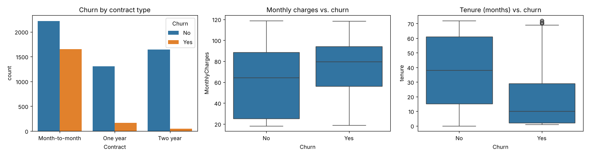

# Customer Churn Prediction

A machine learning model that identifies telecom customers at risk of cancelling their service.



## Data

Telco Customer Churn (IBM), covering 7,043 customers.
Source: [Kaggle: Telco Customer Churn](https://www.kaggle.com/datasets/blastchar/telco-customer-churn).

## Tools

Python, pandas, scikit-learn, seaborn

## Models

- Logistic Regression
- Random Forest

Results (accuracy and recall) are in the notebook [`notebooks/analysis.ipynb`](notebooks/analysis.ipynb).

## How to run

```bash
pip install -r requirements.txt
jupyter notebook notebooks/analysis.ipynb
```
